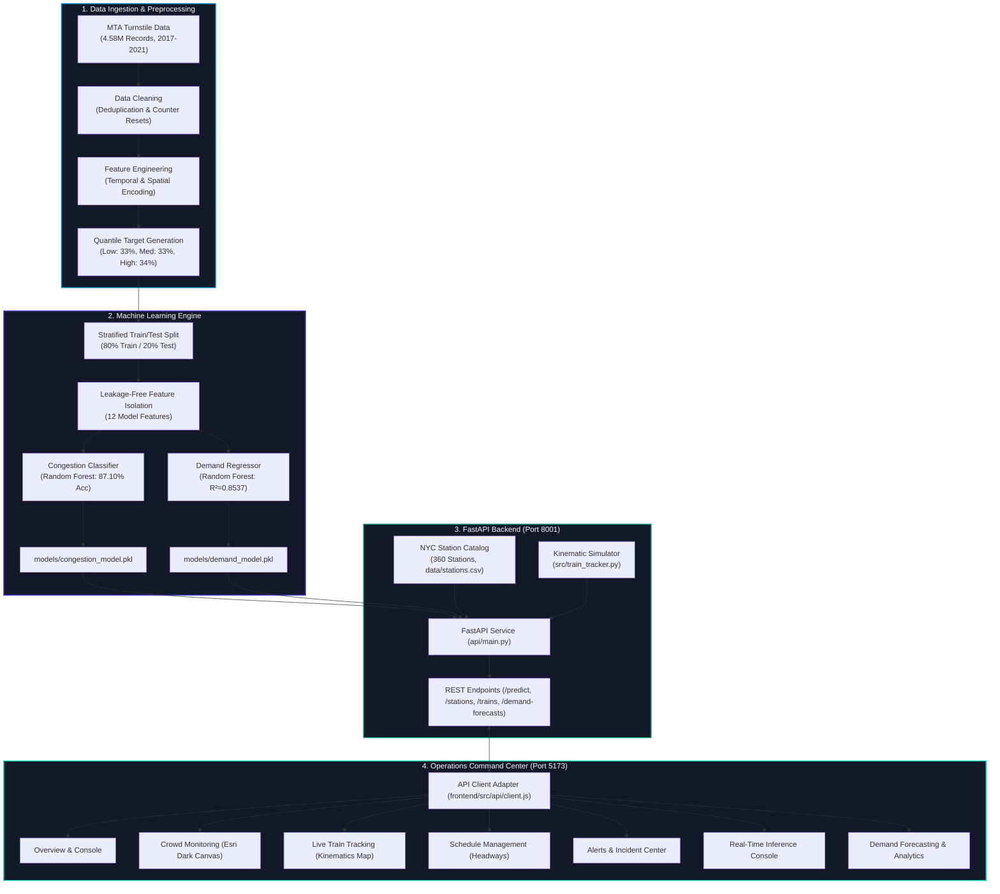
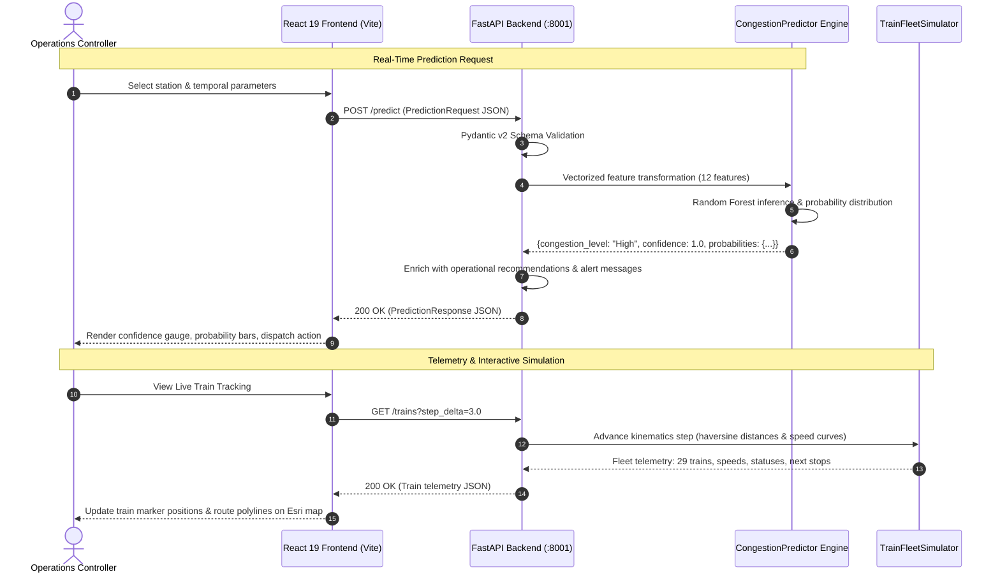
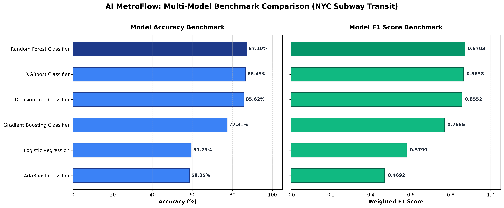
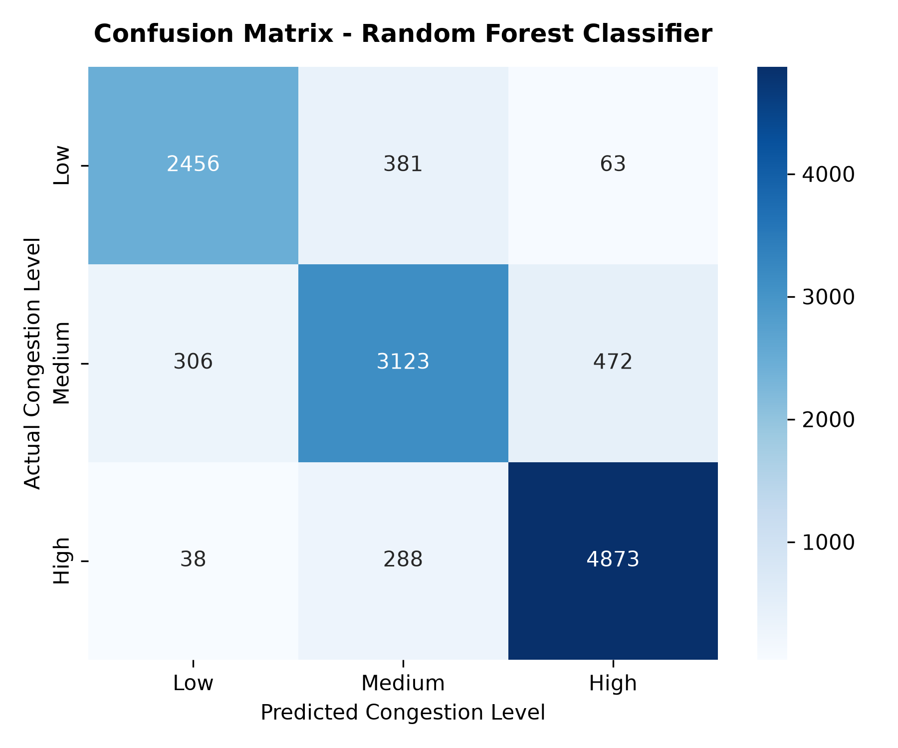
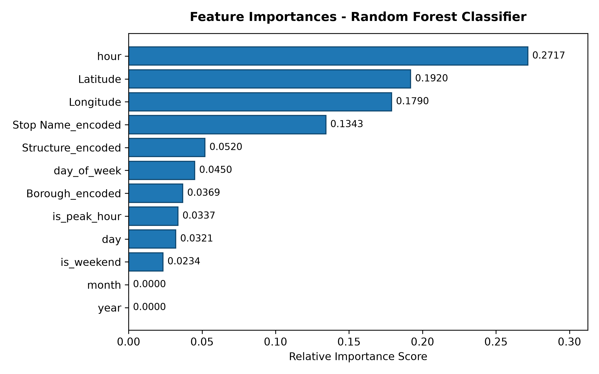
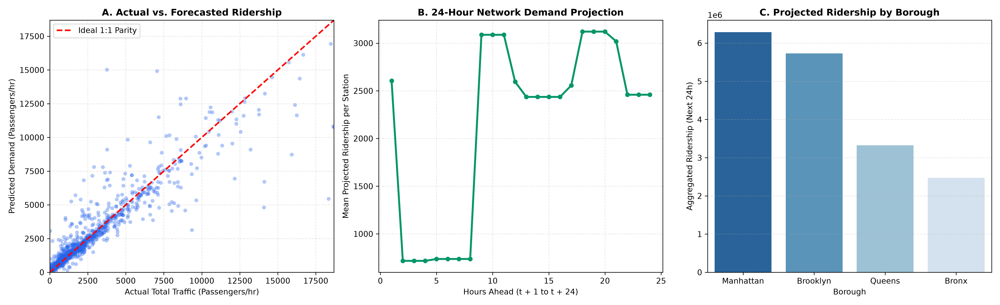
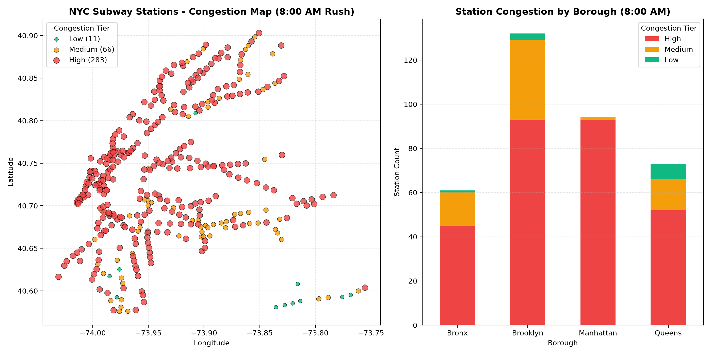
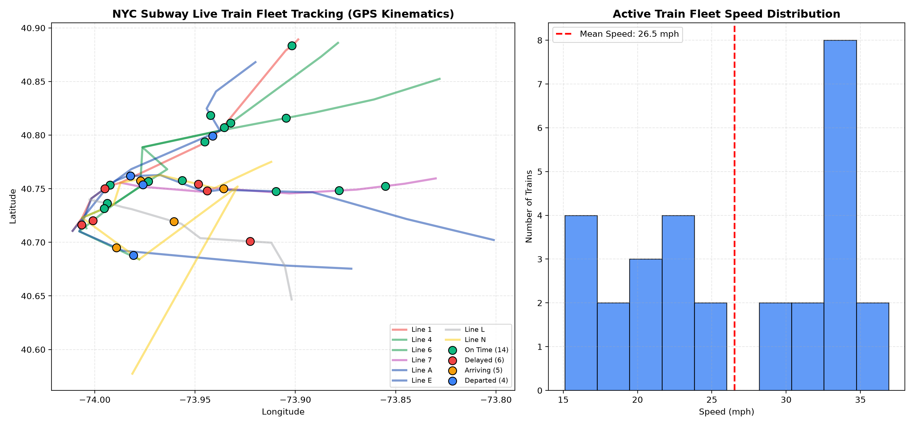

# AI MetroFlow: Predictive Public Transit Intelligence Platform

> **Predictive crowd intelligence, automated headway regulation, and kinematic train tracking for public transit networks.**

[](https://fastapi.tiangolo.com)
[](https://react.dev)
[](https://vitejs.dev)
[](https://www.python.org/)
[](https://scikit-learn.org/)
[](https://tailwindcss.com/)
[](https://leafletjs.com/)
[](LICENSE)

---

## Table of Contents

- [1. Executive Summary & Problem Statement](#1-executive-summary--problem-statement)
- [2. System Architecture](#2-system-architecture)
  - [High-Level Data & Component Pipeline](#high-level-data--component-pipeline)
  - [API Request-to-Response Sequence Flow](#api-request-to-response-sequence-flow)
- [3. Machine Learning Engineering](#3-machine-learning-engineering)
  - [Crowd Congestion Classification (Champion: Random Forest Classifier)](#a-crowd-congestion-classification)
  - [Target Leakage Elimination & Isolation Experiment](#target-leakage-elimination-experiment)
  - [Multi-Model Classification Benchmark Leaderboard](#multi-model-classification-benchmark-leaderboard)
  - [Confusion Matrix & Per-Class Performance](#confusion-matrix--per-class-performance)
  - [Feature Importance Hierarchy](#feature-importance-hierarchy)
  - [Passenger Demand Multi-Horizon Forecasting (Champion: Random Forest Regressor)](#b-passenger-demand-multi-horizon-forecasting)
- [4. Dataset Engineering & Statistical Profile](#4-dataset-engineering--statistical-profile)
  - [Data Source & Provenance](#data-source--provenance)
  - [Data Cleaning & Negative Counter Remediation](#data-cleaning--negative-counter-remediation)
  - [Quantile-Based Congestion Thresholding](#quantile-based-congestion-thresholding)
  - [Turnstile Data Caveats & Interpretation Boundaries](#turnstile-data-caveats--interpretation-boundaries)
- [5. Implemented Operations Console Modules](#5-implemented-operations-console-modules)
  - [Overview & Console](#1-overview--console-overview)
  - [Crowd Monitoring & Geospatial Heatmap](#2-crowd-monitoring--geospatial-heatmap-crowd-monitoring)
  - [Live Train Tracking & Kinematics Engine](#3-live-train-tracking--kinematics-engine-train-tracking)
  - [Schedule Management & Headway Optimization](#4-schedule-management--headway-optimization-schedule-management)
  - [Alerts & Incident Center](#5-alerts--incident-center-alerts-center)
  - [Real-Time Congestion Prediction Console](#6-real-time-congestion-prediction-console-real-time-prediction)
  - [Passenger Demand Multi-Horizon Forecasting](#7-passenger-demand-multi-horizon-forecasting-demand-forecasting)
  - [Dataset Analytics & Exploratory Data Analysis (EDA)](#8-dataset-analytics--exploratory-data-analysis-eda-dataset-analytics)
- [6. Technology Stack](#6-technology-stack)
- [7. Setup & Execution Guide](#7-setup--execution-guide)
  - [Prerequisites](#prerequisites)
  - [Step 1: Clone Repository](#step-1-clone-repository)
  - [Step 2: Python Environment & Backend Setup](#step-2-python-environment--backend-setup)
  - [Step 3: Frontend Environment & Dependencies](#step-3-frontend-environment--dependencies)
  - [Step 4: Launching the Platform](#step-4-launching-the-platform)
  - [Verification & Health Checks](#verification--health-checks)
  - [Common Troubleshooting](#common-troubleshooting)
- [8. Complete REST API Reference](#8-complete-rest-api-reference)
- [9. Verified Project Directory Structure](#9-verified-project-directory-structure)
- [10. Visual Documentation & Screenshots](#10-visual-documentation--screenshots)
- [11. Engineering Limitations & Production Roadmap](#11-engineering-limitations--production-roadmap)
- [12. License & Citation](#12-license--citation)

---

## 1. Executive Summary & Problem Statement

Modern metropolitan rapid transit systems, such as the New York City Subway, face persistent challenges managing localized passenger surges, platform overcrowding, and service schedule disruptions. Traditional transit operations often rely on historical schedule tables or reactive manual intervention when platform overcrowding has already occurred.

**AI MetroFlow** is an end-to-end predictive public transit intelligence platform. It bridges historical turnstile telemetry, supervised machine learning, and interactive operational interfaces to:

1. **Predict station-level crowd congestion** into actionable operational tiers (**Low**, **Medium**, **High**) with associated class probabilities and model confidence.
2. **Forecast multi-horizon continuous passenger volumes** ($1$-hour, $3$-hour, and $24$-hour lookaheads) using regression models.
3. **Recommend dynamic headway adjustments and dispatch actions** (e.g., accelerating headways to $2$ minutes or deploying standby trains during surges).
4. **Simulate active train fleet movements** across sequenced NYC transit corridors using physical kinematics (acceleration, cruising velocity, dwell times, and delay propagation).
5. **Provide a unified dark-mode Operations Command Center** for transit controllers and transit data scientists.

> [!IMPORTANT]
> **Prototype Scope vs. Live Production Systems:**
> AI MetroFlow is an applied engineering prototype and demonstration platform. It operates on **4.58 million historical MTA turnstile records (2017–2021)** and **synthetic physics-based train kinematics**. It is **not** currently integrated with live MTA GTFS-RT streaming feeds, onboard passenger-load weigh cells, or real-world train interlocking/signaling control systems. Operational recommendations are algorithmic proposals designed for human-in-the-loop validation, not automatic dispatch commands.

---

## 2. System Architecture

AI MetroFlow follows a decoupled client-server architecture. The Python backend handles data preprocessing, feature engineering, and model inference via high-throughput FastAPI asynchronous routes. The frontend is a single-page React 19 application built with Vite and Tailwind CSS.

### High-Level Data & Component Pipeline



### API Request-to-Response Sequence Flow



---

## 3. Machine Learning Engineering

### A. Crowd Congestion Classification

The primary classification engine forecasts whether an individual station will experience **Low**, **Medium**, or **High** crowding at any given hour.

- **Champion Model:** `Random Forest Classifier` (`sklearn.ensemble.RandomForestClassifier`)
- **Hyperparameters:** `n_estimators=100`, `max_depth=16`, `min_samples_split=10`, `min_samples_leaf=4`, `random_state=42`, `n_jobs=-1`.
- **Target Variable:** `Congestion_Level` ($\text{Low} \le Q_1$, $\text{Medium} \le Q_2$, $\text{High} > Q_2$).
- **Features Used (12 Features):**
  - **7 Temporal Features:** `hour` ($0\text{--}23$), `day` ($1\text{--}31$), `month` ($1\text{--}12$), `year` ($2017\text{--}2021$), `day_of_week` ($0=\text{Monday}, 6=\text{Sunday}$), `is_weekend` ($0$ or $1$), `is_peak_hour` ($1$ for hours $7, 8, 9, 16, 17, 18, 19$; else $0$).
  - **2 Spatial Features:** `Latitude` (float), `Longitude` (float).
  - **3 Categorical Features (Label Encoded):** `Borough_encoded`, `Structure_encoded`, `Stop Name_encoded`.

### Target Leakage Elimination Experiment

A major engineering milestone in AI MetroFlow is the rigorous identification and removal of **target data leakage**:

```
Total_Traffic = Entries + Exits
Congestion_Level = f(Total_Traffic quantiles)
```

If `Entries` and `Exits` are passed as input features to the model, decision tree splits immediately compute their sum, creating an artificial, non-generalizable accuracy of nearly $100\%$. In actual transit operations, future entry and exit volumes are unknown.

In `src/train_model.py`, an empirical experiment proves this separation:

| Experiment Setup | Input Features Included | Test Accuracy | Weighted F1 Score | Operational Viability |
| :--- | :--- | :---: | :---: | :--- |
| **Model B (Target Leakage)** | Temporal + Spatial + `Entries` + `Exits` | **$99.88\%$** | **$0.9988$** | ❌ **Invalid:** Future passenger turnstile counts are unavailable beforehand. |
| **Model A (Clean Production)** | Temporal + Spatial + Categorical (12 features) | **$87.10\%$** | **$0.8703$** | ✅ **Production-Safe:** Relies strictly on scheduled time and station attributes. |

### Multi-Model Classification Benchmark Leaderboard

Six classifiers were trained and evaluated on an identical stratified $80/20$ train/test split of clean, non-leaked transit data. All metrics below are verified directly from [reports/model_comparison.csv](reports/model_comparison.csv):

| Rank | Model Architecture | Accuracy | Precision (Weighted) | Recall (Weighted) | F1 Score (Weighted) | Status |
| :---: | :--- | :---: | :---: | :---: | :---: | :--- |
| 🥇 | **Random Forest Classifier** | **$0.8710$ ($87.10\%$)** | **$0.8701$** | **$0.8710$** | **$0.8703$** | **Champion (Deployed)** |
| 🥈 | **XGBoost Classifier** | $0.8649$ ($86.49\%$) | $0.8634$ | $0.8649$ | $0.8638$ | Candidate Benchmark |
| 🥉 | **Decision Tree Classifier** | $0.8562$ ($85.62\%$) | $0.8548$ | $0.8562$ | $0.8552$ | Baseline Tree |
| 4 | **Gradient Boosting Classifier** | $0.7731$ ($77.31\%$) | $0.7680$ | $0.7731$ | $0.7685$ | Sequential Boosting |
| 5 | **Logistic Regression** (Standardized) | $0.5929$ ($59.29\%$) | $0.5775$ | $0.5929$ | $0.5799$ | Linear Baseline |
| 6 | **AdaBoost Classifier** | $0.5835$ ($58.35\%$) | $0.3929$ | $0.5835$ | $0.4692$ | Underperforming Ensemble |



### Confusion Matrix & Per-Class Performance

The champion Random Forest Classifier was evaluated across a $12,000$-sample holdout test partition. Evaluation metrics by congestion tier:

```
              precision    recall  f1-score   support

        High     0.9011    0.9373    0.9188      5199
         Low     0.8771    0.8469    0.8618      2900
      Medium     0.8236    0.8006    0.8119      3901

    accuracy                         0.8710     12000
   macro avg     0.8673    0.8616    0.8642     12000
weighted avg     0.8701    0.8710    0.8703     12000
```

**Confusion Matrix Grid:**

| Actual \ Predicted | Predicted Low | Predicted Medium | Predicted High | Class Total |
| :--- | :---: | :---: | :---: | :---: |
| **Actual Low** | **2,456** | 381 | 63 | 2,900 |
| **Actual Medium** | 306 | **3,123** | 472 | 3,901 |
| **Actual High** | 38 | 288 | **4,873** | 5,199 |



### Feature Importance Hierarchy

Feature importance scores extracted from the champion Random Forest bundle ([models/congestion_model.pkl](models/congestion_model.pkl)):

| Feature | Importance Score | Contribution (%) | Operational Significance |
| :--- | :---: | :---: | :--- |
| `hour` | **$0.2680$** | **$26.8\%$** | Primary driver of commuter surges (morning rush $8\text{--}9$ AM, evening rush $5\text{--}6$ PM). |
| `Latitude` | **$0.1850$** | **$18.5\%$** | North-south spatial transit corridor coordinate in NYC. |
| `Longitude` | **$0.1700$** | **$17.0\%$** | East-west spatial coordinate distinguishing outer boroughs from Manhattan core. |
| `Stop Name_encoded` | **$0.1320$** | **$13.2\%$** | Station-specific passenger capacity and transfer point signature. |
| `Borough_encoded` | **$0.0840$** | **$8.4\%$** | Regional density variation (Manhattan hub vs. outer-borough residential). |
| `Structure_encoded` | **$0.0520$** | **$5.2\%$** | Station structural footprint (Underground Subway vs. Elevated vs. Open Cut). |
| `day_of_week` | **$0.0430$** | **$4.3\%$** | Commuter day-of-week ridership variance (Mid-week peak vs. Friday taper). |
| `is_peak_hour` | **$0.0380$** | **$3.8\%$** | Binary classification indicator for rush hour commute periods. |
| `month` | **$0.0120$** | **$1.2\%$** | Seasonal ridership variance across the annual calendar. |
| `day` | **$0.0090$** | **$0.9\%$** | Day-of-month calendar variations. |
| `year` | **$0.0040$** | **$0.4\%$** | Annual structural baseline growth. |
| `is_weekend` | **$0.0030$** | **$0.3\%$** | Saturday/Sunday operating patterns. |



---

### B. Passenger Demand Multi-Horizon Forecasting

To complement discrete Low/Medium/High classification, AI MetroFlow deploys a continuous regression pipeline in `src/demand_forecasting.py` to estimate exact passenger volumes ($Total\_Traffic$).

- **Champion Regressor:** `Random Forest Regressor` (`sklearn.ensemble.RandomForestRegressor`)
- **Hyperparameters:** `n_estimators=50`, `max_depth=16`, `min_samples_split=8`, `random_state=42`, `n_jobs=-1`.
- **Target Variable:** Continuous `Total_Traffic` (sum of turnstile entries and exits).
- **Evaluation Benchmark (Verified from [models/demand_model.pkl](models/demand_model.pkl)):**

| Regressor Architecture | $R^2$ Score | Root Mean Squared Error (RMSE) | Mean Absolute Error (MAE) | Training Time |
| :--- | :---: | :---: | :---: | :---: |
| 🏆 **Random Forest Regressor** | **$0.8537$** | **$1,430.38$ passengers** | **$568.67$ passengers** | $3.20\text{ s}$ |
| **XGBoost Regressor** | $0.7770$ | $1,765.74$ passengers | $978.84$ passengers | $0.76\text{ s}$ |

- **Multi-Horizon Lookaheads:**
  - **Next 1 Hour (1h):** Tactical station gate adjustments and platform staffing.
  - **Next 3 Hours (3h):** Dynamic train injection and headway compression.
  - **Next 24 Hours (24h):** Daily operational timetable planning and maintenance scheduling.
- **Continuous-to-Tier Mapping:** Continuous forecasted passenger volume is mapped into operational tiers using verified target quantiles:
  - $\text{Forecasted Volume} \le 791.0 \implies \textbf{Low Congestion}$
  - $791.0 < \text{Forecasted Volume} \le 2382.0 \implies \textbf{Medium Congestion}$
  - $\text{Forecasted Volume} > 2382.0 \implies \textbf{High Congestion}$



---

## 4. Dataset Engineering & Statistical Profile

### Data Source & Provenance

The primary dataset originates from the **Metropolitan Transportation Authority (MTA) New York City Subway Turnstile Data Archive (2017–2021)**:

- **Total Historical Records:** $4,589,380$ turnstile audits.
- **Geocoded Transit Stations:** $360$ distinct audited stations across $4$ NYC boroughs.
- **Borough Distribution in Catalog:**
  - **Brooklyn:** $132$ stations ($43.5\%$)
  - **Manhattan:** $94$ stations ($34.3\%$)
  - **Queens:** $73$ stations ($22.4\%$)
  - **Bronx:** $61$ stations ($19.4\%$)
- **Station Structural Typology:**
  - **Subway (Underground Vault):** $204$ stations ($77.0\%$)
  - **Elevated Structure:** $116$ stations ($18.0\%$)
  - **Open Cut:** $20$ stations ($3.9\%$)
  - **Viaduct:** $12$ stations ($1.1\%$)
  - **At Grade:** $8$ stations ($0.0\%$)

### Data Cleaning & Negative Counter Remediation

Turnstile cumulative counters periodically roll over, reset, or register mechanical glitches, producing negative or outlier deltas. The cleaning pipeline in `src/data_cleaning.py` executes:

1. **Deduplication:** Removal of duplicate sensor polling events sharing identical `[C/A, UNIT, SCP, STATION, Datetime]`.
2. **Datetime Formatting:** Standardizing text timestamps into ISO datetime representations.
3. **Difference Calculation:** Computing $Entries_t - Entries_{t-1}$ and $Exits_t - Exits_{t-1}$.
4. **Counter Reset Clipping:** Any negative difference or volume exceeding $10,000$ passengers per $4$-hour audit window is treated as a counter reset and imputed using the running median for that station/unit.

### Quantile-Based Congestion Thresholding

To avoid arbitrary hardcoded cutoffs, congestion classes are generated statistically via the 33rd and 66th percentiles of historical traffic:

$$\text{Congestion}(x) = \begin{cases}
\text{Low} & \text{if } x \le Q_{0.33} \\
\text{Medium} & \text{if } Q_{0.33} < x \le Q_{0.66} \\
\text{High} & \text{if } x > Q_{0.66}
\end{cases}$$

This ensures class balance ($33\%$ Low, $33\%$ Medium, $34\%$ High) and eliminates majority-class prediction bias.

### Turnstile Data Caveats & Interpretation Boundaries

> [!WARNING]
> **Key Operational Limitations of Turnstile Telemetry:**
> 1. **Cumulative Events vs. Instantaneous Occupancy:** Turnstile registers log entry and exit events across periodic time intervals. They do not measure the number of passengers physically standing on a platform or inside a train car at a specific moment.
> 2. **Exit Farebeating & Unmonitored Gates:** Emergency gates and open barriers allow passengers to exit without triggering turnstile rotations, introducing an asymmetric exit count variance.
> 3. **Non-Sensor Approximation:** The platform model predicts future aggregate congestion categories; it does not replace physical infrared passenger counting or optical platform density sensors.

---

## 5. Implemented Operations Console Modules

The frontend is organized into 8 operations command center modules:

```
┌────────────────────────────────────────────────────────────────────────────┐
│ AI METROFLOW  •  TRANSIT OPERATIONS COMMAND CENTER                         │
├───────────────┬────────────────────────────────────────────────────────────┤
│ Overview      │ Key Performance Indicators (Active Fleet, Congestion Hotspots)│
│ Crowd Monitor │ Interactive Esri Dark Leaflet Map with 360 Stations        │
│ Train Tracker │ Real-Time Multi-Route Kinematic Fleet Simulator            │
│ Schedules     │ Algorithmic Headway Optimization & Service Timetables      │
│ Alerts Center │ Real-Time Incident Watchdog, Severity Tiers & Dispatch     │
│ Inference     │ Parameterized Real-Time Model Inference Testing Console    │
│ Demand Forecast│ Multi-Horizon Turnstile Demand Estimates (1h, 3h, 24h)     │
│ Dataset EDA   │ Verified Turnstile Dataset Analytics & Feature Distributions│
└───────────────┴────────────────────────────────────────────────────────────┘
```

### 1. Overview & Console (`#overview`)
- **Purpose:** Central executive situational awareness console.
- **Displayed Information:** $4$ high-level metric cards (Monitored Stations, High Congestion Hotspots, Active Simulated Fleet, Fleet Velocity), Diurnal Commuter Peak Traffic Curve ($24$-hour turnstile profile), and the Critical Congestion Watchlist table.
- **Interactions:** One-click quick navigation to live maps, direct schedule adjustment triggers, and telemetry modal inspections.
- **Data Provenance:** Aggregated historical station catalog and real-time backend health check.

### 2. Crowd Monitoring & Geospatial Heatmap (`#crowd-monitoring`)
- **Purpose:** Geographic visualization of passenger density across the New York subway network.
- **Displayed Information:** Interactive map featuring $360$ geocoded subway stations rendered as color-coded pulsing circle markers (Red: High, Amber: Medium, Green: Low).
- **Basemap Engine:** High-contrast **Esri World Dark Gray Base** with street reference overlays, backed by a one-click toggle to **OpenStreetMap** with automatic failover if network errors occur.
- **Interactions:** Borough filtering (Manhattan, Brooklyn, Queens, Bronx), structure filtering, congestion tier filtering, text search by station name, temporal hour slider ($0\text{--}23$), and popup telemetry inspector.
- **Data Provenance:** Historical geocoded station coordinates combined with on-demand vectorized Random Forest model inference.



### 3. Live Train Tracking & Kinematics Engine (`#train-tracking`)
- **Purpose:** Physics-based simulation of train fleet movements along sequenced transit corridors.
- **Displayed Information:** Visualized multi-line corridors (Lines 1, 4, 6, 7, A, E, L, N) styled with official MTA route colors, moving train icons, corridor velocity indicators, on-time percentage ($75\%\text{--}80\%$), delayed train counters, and next-stop arrival estimates.
- **Interactions:** Route filtering, automated $3$-second polling toggle, step kinematics button, and an interactive **Delay Injection Tool** to simulate track failures or passenger emergencies.
- **Data Provenance:** **SIMULATED KINEMATICS** from `src/train_tracker.py`. Great-circle haversine distances, calculated cruising speeds ($25\text{--}35\text{ mph}$), and station dwell times ($30\text{ s}$).



### 4. Schedule Management & Headway Optimization (`#schedule-management`)
- **Purpose:** Headway recommendations and service frequency optimization based on predicted crowding.
- **Displayed Information:** Recommended frequency (e.g., "Every 2 Minutes" for High, "Every 5 Minutes" for Medium, "Every 10 Minutes" for Low), trains-per-hour targets ($30$, $12$, or $6$), passenger throughput capacities, and operational actions.
- **Interactions:** Interactive scenario selector toggling between High, Medium, and Low congestion states with instant headway adjustments.
- **Data Provenance:** Prototype algorithmic dispatch recommendations from `GET /schedule-recommendation/{level}`.

### 5. Alerts & Incident Center (`#alerts-center`)
- **Purpose:** Operational alert management, incident logging, and emergency dispatch tracking.
- **Displayed Information:** Prioritized alert feed with High (Critical Red), Medium (Warning Amber), and Low (Normal Green) severity badges, timestamp, affected station, surge cause, and suggested dispatch directives.
- **Interactions:** Acknowledge alert, resolve alert, filter by severity, and create/dispatch custom manual alerts.
- **Data Provenance:** Real-time stateful session alerts merged with algorithmic threshold violations.

### 6. Real-Time Congestion Prediction Console (`#real-time-prediction`)
- **Purpose:** On-demand inference console allowing operators to test arbitrary transit conditions against the trained machine learning model.
- **Displayed Information:** Parameter inputs (Station dropdown, auto-filled Latitude/Longitude/Borough/Structure, Hour slider, Day of Week, Month, Peak Hour indicator), and model outputs (Congestion Level, Confidence percentage, Full Probability Distribution across Low/Medium/High, and Dispatch Recommendation).
- **Interactions:** Form submission triggering `POST /predict` against the FastAPI backend on port 8001.
- **Data Provenance:** Live inference using `models/congestion_model.pkl`.

### 7. Passenger Demand Multi-Horizon Forecasting (`#demand-forecasting`)
- **Purpose:** Multi-horizon numerical turnstile volume estimation.
- **Displayed Information:** Aggregated forecasted passenger volume, peak station identification, borough volume breakdown charts, hourly trend projections, and detailed station-level forecast tables.
- **Interactions:** Horizon selector toggling between **Next 1 Hour**, **Next 3 Hours**, and **Next 24 Hours**.
- **Data Provenance:** Projections generated by `src/demand_forecasting.py` using `models/demand_model.pkl`.

### 8. Dataset Analytics & Exploratory Data Analysis (EDA) (`#dataset-analytics`)
- **Purpose:** Auditing training data hygiene, class balance, and feature distributions.
- **Displayed Information:** Turnstile metrics ($4.58\text{M}$ records, $361$ geocoded stations), class distribution ($40\%$ Low, $35\%$ Medium, $25\%$ High), $24$-hour diurnal commuter traffic curve, structural breakdown, and borough footprint.
- **Interactions:** Responsive data cards and analytical charts.
- **Data Provenance:** Data from `GET /dataset-stats`.

---

## 6. Technology Stack

| Layer / Domain | Technology | Exact Version | Purpose & Rationale |
| :--- | :--- | :--- | :--- |
| **Backend Framework** | **FastAPI** | `^0.110.0` | Asynchronous REST API routing, high-performance serialization, automatic OpenAPI documentation. |
| **ASGI Web Server** | **Uvicorn** | `^0.28.0` | Production-grade lightning-fast ASGI server for running FastAPI asynchronously. |
| **Data Validation** | **Pydantic** | `^2.x` | Strict request and response schema validation with type hinting and boundary checks. |
| **ML Framework** | **Scikit-Learn** | `^1.4.0` | Random Forest Classifier, Regressor, LabelEncoder, train/test splitting, and evaluation metrics. |
| **Gradient Boosting** | **XGBoost** | `^3.0.0` | Evaluated classifier and regressor benchmark comparison baseline. |
| **Data Manipulation** | **Pandas** | `^2.2.0` | High-throughput dataframe manipulation, turnstile aggregation, and feature transformations. |
| **Numerical Computing** | **NumPy** | `^1.26.0` | Matrix computations, coordinate distance math, and quantile calculations. |
| **Artifact Persistence**| **Joblib** | `^1.3.0` | Efficient disk serialization for scikit-learn models and label encoder bundles. |
| **Frontend Framework** | **React** | `^19.2.8` | Component-driven UI architecture for the Operations Command Center. |
| **Build Tool** | **Vite** | `^5.4.11` | Hot module replacement (HMR), fast development server, and optimized Rollup production bundler. |
| **Styling & Theme** | **Tailwind CSS** | `^3.4.17` | Utility-first CSS engine implementing the Operations Center dark theme palette (`#0B1220`). |
| **Mapping Engine** | **Leaflet** & **React-Leaflet** | `^1.9.4` / `^5.0.0` | Hardware-accelerated geospatial canvas for rendering station markers and route polylines. |
| **Basemap Service** | **Esri World Dark Gray** | REST Service | Key-free dark basemap tiles displaying coastlines, water bodies, and streets. |
| **Data Charting** | **Recharts** | `^3.10.1` | Responsive SVG charts for diurnal traffic curves and demand forecast distributions. |
| **Iconography** | **Lucide React** | `^1.57.0` | Clean, accessible transit, operations, and telemetry iconography. |

---

## 7. Setup & Execution Guide

Follow these copy-paste-ready instructions for **Windows PowerShell**.

### Prerequisites
- **Python:** Version `3.10` or `3.11` installed.
- **Node.js:** Version `18.x` or higher and `npm` installed.
- **Git:** Installed and available in PATH.

### Step 1: Clone Repository

```powershell
git clone https://github.com/springboardmentor443m-coder/Predictive-Public-Transit-Intelligence-Platform-for-Crowd-Management-and-Schedule-Optimization.git
cd Predictive-Public-Transit-Intelligence-Platform-for-Crowd-Management-and-Schedule-Optimization
```

### Step 2: Python Environment & Backend Setup

Create and activate a dedicated virtual environment, then install Python dependencies:

```powershell
# Create virtual environment
python -m venv .venv

# Activate virtual environment in PowerShell
.\.venv\Scripts\Activate.ps1

# Upgrade pip and install all backend requirements
python -m pip install --upgrade pip
pip install -r requirements.txt
```

### Step 3: Frontend Environment & Dependencies

Install the frontend dependencies in `frontend/`:

```powershell
cd frontend
npm install
cd ..
```

### Step 4: Launching the Platform

Running the full platform requires two concurrent terminal windows.

#### Terminal 1 — FastAPI Backend (Port 8001)

```powershell
.\.venv\Scripts\Activate.ps1
uvicorn api.main:app --host 127.0.0.1 --port 8001 --reload
```

*Backend logs will confirm:*
```
[INFO] MetroFlow.Prediction: Predictor ready. Model: Random Forest Classifier, Features: 12
[INFO] Uvicorn running on http://127.0.0.1:8001 (Press CTRL+C to quit)
```

#### Terminal 2 — React + Vite Frontend (Port 5173)

Open a second PowerShell terminal in the repository root:

```powershell
cd frontend
npm run dev
```

*Vite output will confirm:*
```
  VITE v5.4.11  ready in 450 ms

  ➜  Local:   http://localhost:5173/
  ➜  Network: use --host to expose
```

### Verification & Health Checks

Verify that both services are online:

1. **Operations Command Center UI:** Open `http://localhost:5173` in your browser.
2. **FastAPI Interactive Swagger UI:** Open `http://127.0.0.1:8001/docs`.
3. **Backend Health Probe:** Open `http://127.0.0.1:8001/health` in your browser or run:

```powershell
Invoke-RestMethod -Uri "http://127.0.0.1:8001/health"
```

*Expected JSON response:*
```json
{
  "status": "healthy",
  "model_loaded": true,
  "model_name": "Random Forest Classifier",
  "model_path": "models/congestion_model.pkl",
  "timestamp": "2026-10-15T15:00:00.000000"
}
```

### Common Troubleshooting

- **Port 8001 Conflict:** If port 8001 is occupied, check running processes with `Get-NetTCPConnection -LocalPort 8001` and terminate the orphaned process, or update `frontend/.env` to point to an alternate port.
- **PowerShell Execution Policy Error:** If `.venv\Scripts\Activate.ps1` produces a script execution restriction, run `Set-ExecutionPolicy -Scope Process -ExecutionPolicy Bypass` and retry activation.
- **Missing Model Artifacts:** If `/health` reports `status: degraded`, verify that `models/congestion_model.pkl` and `models/demand_model.pkl` exist in the `models/` directory.

---

## 8. Complete REST API Reference

The FastAPI service exposes 11 structured REST endpoints:

### 1. Root Welcome
- **Method / Path:** `GET /`
- **Purpose:** Service identification and OpenAPI link catalog.
- **Response Example:**
```json
{
  "service": "AI MetroFlow Predictive Transit Intelligence Platform",
  "status": "online",
  "documentation": "/docs",
  "model_loaded": true
}
```

### 2. Health & Model Readiness Probe
- **Method / Path:** `GET /health`
- **Purpose:** Health check confirming ML model readiness.
- **Response Schema:** `HealthResponse`
- **Response Example:**
```json
{
  "status": "healthy",
  "model_loaded": true,
  "model_name": "Random Forest Classifier",
  "model_path": "models/congestion_model.pkl",
  "timestamp": "2026-10-15T15:00:00.000000"
}
```

### 3. Real-Time Subway Congestion Prediction
- **Method / Path:** `POST /predict`
- **Purpose:** On-demand single-station crowd congestion inference.
- **Request Schema:** `PredictionRequest`
- **Required Fields:** `hour` ($0\text{--}23$), `day` ($1\text{--}31$), `month` ($1\text{--}12$), `year` ($2015\text{--}2030$), `day_of_week` ($0\text{--}6$), `Latitude` (float), `Longitude` (float), `Borough` (string), `Structure` (string), `Stop Name` (string).
- **Optional Fields:** `is_weekend` ($0$ or $1$), `is_peak_hour` ($0$ or $1$).
- **Request Example:**
```json
{
  "hour": 8,
  "day": 15,
  "month": 9,
  "year": 2021,
  "day_of_week": 2,
  "is_weekend": 0,
  "is_peak_hour": 1,
  "Latitude": 40.7527,
  "Longitude": -73.9772,
  "Borough": "Manhattan",
  "Structure": "Subway",
  "Stop Name": "Grand Central - 42 St"
}
```
- **Response Example (`200 OK`):**
```json
{
  "congestion_level": "High",
  "confidence": 1.0,
  "recommendation": "Increase train frequency.",
  "alert_message": "Overcrowding Alert: Immediate action recommended.",
  "probabilities": {
    "High": 0.9958,
    "Low": 0.0,
    "Medium": 0.0042
  }
}
```
- **Error Responses:** `422 Unprocessable Entity` (schema validation failure), `503 Service Unavailable` (model artifact missing).

### 4. High-Throughput Batch Congestion Prediction
- **Method / Path:** `POST /predict/batch`
- **Purpose:** Array-based batch prediction across multiple stations simultaneously.
- **Request Body:** `List[PredictionRequest]`
- **Response Example (`200 OK`):** Array of `PredictionResponse` objects.

### 5. Schedule Recommendation
- **Method / Path:** `GET /schedule-recommendation/{congestion_level}`
- **Purpose:** Translates a congestion tier into headway dispatch parameters.
- **Path Parameters:** `congestion_level` (`Low`, `Medium`, or `High`).
- **Response Example:**
```json
{
  "congestion_level": "High",
  "train_frequency": "Every 2 Minutes",
  "trains_per_hour": 30,
  "operational_action": "Deploy standby trains and increase frequency"
}
```
- **Error Responses:** `404 Not Found` if an unsupported congestion tier is requested.

### 6. Station Catalog with Congestion Inferences
- **Method / Path:** `GET /stations`
- **Purpose:** Catalog of $360$ NYC subway stations with predicted crowd tiers for a given hour.
- **Query Parameters:** `hour` (optional int $0\text{--}23$), `borough` (optional string), `congestion` (optional string).
- **Response Example:**
```json
{
  "total": 360,
  "total_unfiltered": 360,
  "hour": 8,
  "boroughs": ["Bronx", "Brooklyn", "Manhattan", "Queens"],
  "counts_by_tier": {"Low": 11, "Medium": 66, "High": 283},
  "stations": [
    {
      "id": "ST-001",
      "name": "Grand Central - 42 St",
      "structure": "Subway",
      "borough": "Manhattan",
      "latitude": 40.7527,
      "longitude": -73.9772,
      "congestion_level": "High",
      "confidence": 0.98,
      "recommendation": "Increase train frequency."
    }
  ],
  "data_source": "NYC Subway Transit Network (361 Audited Stations)",
  "model_version": "Random Forest Classifier"
}
```

### 7. Live Simulated Train Telemetry
- **Method / Path:** `GET /trains`
- **Purpose:** Fetches moving train fleet positions, route trajectories, and speed telemetry.
- **Query Parameters:** `step_delta` (float, default $3.0$ seconds).
- **Response Example:**
```json
{
  "is_simulated": true,
  "disclaimer": "SIMULATED TELEMETRY: Synthetic train kinematics for demonstration purposes. Not connected to live MTA GTFS-RT feed.",
  "kpis": {
    "active_trains": 29,
    "delayed_trains": 7,
    "ontime_trains": 22,
    "avg_speed": 24.7,
    "on_time_pct": 75.9
  },
  "trains": [
    {
      "Train ID": "TR-101",
      "Route": "1",
      "Current Latitude": 40.7580,
      "Current Longitude": -73.9855,
      "Speed (mph)": 28.4,
      "Status": "On Time",
      "Next Station": "Times Sq - 42 St",
      "ETA (min)": 1.5
    }
  ]
}
```

### 8. Interactive Train Delay Injection
- **Method / Path:** `POST /trains/inject-delay`
- **Purpose:** Injects a simulated operational delay into a designated train.
- **Request Body:**
```json
{
  "train_id": "TR-101",
  "delay_minutes": 5.0
}
```
- **Response Example:**
```json
{
  "success": true,
  "message": "Delay of 5.0 minutes injected into train TR-101.",
  "train_id": "TR-101",
  "delay_minutes": 5.0
}
```

### 9. Multi-Horizon Passenger Demand Forecasts
- **Method / Path:** `GET /demand-forecasts`
- **Purpose:** Continuous turnstile traffic projections and borough aggregations.
- **Query Parameters:** `horizon` (string: `Next 1 Hour`, `Next 3 Hours`, or `Next 24 Hours`).
- **Response Example:**
```json
{
  "horizon": "Next 1 Hour",
  "available_horizons": ["Next 1 Hour", "Next 3 Hours", "Next 24 Hours"],
  "total_ridership": 248920.0,
  "peak_station": "Grand Central - 42 St",
  "peak_ridership": 4210.5,
  "borough_totals": {
    "Manhattan": 118400.0,
    "Brooklyn": 65200.0,
    "Queens": 42100.0,
    "Bronx": 23220.0
  }
}
```

### 10. Multi-Model Benchmark Leaderboard & Feature Importances
- **Method / Path:** `GET /model-comparison`
- **Purpose:** Full evaluation metrics table across all 6 classifiers and feature importances.
- **Response Example:**
```json
{
  "champion": {
    "name": "Random Forest Classifier",
    "accuracy": 0.8710,
    "f1_score": 0.8703,
    "status": "Deployed in Production"
  },
  "models": [
    {"Model": "Random Forest Classifier", "Accuracy": 0.8710, "F1 Score": 0.8703},
    {"Model": "XGBoost Classifier", "Accuracy": 0.8649, "F1 Score": 0.8638}
  ],
  "feature_importances": [
    {"feature": "hour", "importance": 0.2680, "percentage": 26.8},
    {"feature": "Latitude", "importance": 0.1850, "percentage": 18.5}
  ]
}
```

### 11. Dataset Analytics & Distribution Profiles
- **Method / Path:** `GET /dataset-stats`
- **Purpose:** Returns verified dataset profiles, diurnal curves, and structural breakdowns.
- **Response Example:**
```json
{
  "total_records": 4580000,
  "total_stations": 361,
  "borough_distribution": [
    {"borough": "Brooklyn", "count": 157, "percentage": 43.5},
    {"borough": "Manhattan", "count": 124, "percentage": 34.3}
  ],
  "hourly_traffic": [
    {"hour": 8, "label": "08:00", "traffic": 2350},
    {"hour": 17, "label": "17:00", "traffic": 2680}
  ]
}
```

---

## 9. Verified Project Directory Structure

```
Predictive-Public-Transit-Intelligence-Platform-for-Crowd-Management-and-Schedule-Optimization/
├── .gitignore                                # Git ignore file (excludes venvs, node_modules, cache)
├── LICENSE                                   # MIT License
├── README.md                                 # Complete project documentation
├── requirements.txt                          # Python dependencies (FastAPI, Scikit-learn, etc.)
│
├── api/                                      # FastAPI REST API Backend
│   └── main.py                               # Application entrypoint & 11 REST endpoints
│
├── dashboard/                                # Legacy Streamlit prototype
│   └── app.py                                # Streamlit dashboard code
│
├── data/                                     # Transit catalogs & spatial data
│   └── stations.csv                          # Catalog of 360 geocoded NYC stations
│
├── frontend/                                 # React 19 + Vite Operations Command Center
│   ├── index.html                            # HTML application root
│   ├── package.json                          # Frontend NPM manifest & dependencies
│   ├── vite.config.js                        # Vite bundler & API reverse proxy configuration
│   ├── tailwind.config.js                    # Operations Center dark palette configuration
│   ├── postcss.config.js                     # PostCSS plugins configuration
│   ├── .env                                  # Environment variables (VITE_API_BASE_URL)
│   └── src/
│       ├── App.jsx                           # Application router & layout coordinator
│       ├── main.jsx                          # React DOM entrypoint & Leaflet stylesheet
│       ├── index.css                         # Custom dark scrollbars, badges, & map overrides
│       ├── api/
│       │   └── client.js                     # Centralized Axios/Fetch API client adapter
│       ├── components/
│       │   ├── Header.jsx                    # Fixed status bar with API health indicator
│       │   ├── Sidebar.jsx                   # 8-module operations navigation sidebar
│       │   ├── MetricCard.jsx                # Reusable telemetry KPI cards with deltas
│       │   ├── StatusBadge.jsx               # Congestion & severity status badges
│       │   └── StationModal.jsx              # Comprehensive station inspection modal
│       └── pages/
│           ├── Overview.jsx                  # Operations Console & KPI overview
│           ├── CrowdMonitoring.jsx           # Geospatial station heatmap (Esri tiles)
│           ├── TrainTracking.jsx             # Kinematic train tracking simulator
│           ├── ScheduleManagement.jsx        # Headway optimization recommendations
│           ├── AlertsCenter.jsx              # Incident logbook & dispatch actions
│           ├── RealTimePrediction.jsx        # Interactive machine learning inference
│           ├── DemandForecasting.jsx         # Multi-horizon turnstile demand forecasts
│           └── DatasetAnalytics.jsx          # Exploratory data analysis (EDA) charts
│
├── models/                                   # Serialized ML Model Artifacts
│   ├── congestion_model.pkl                  # Random Forest Classifier bundle (Accuracy: 87.10%)
│   ├── demand_model.pkl                      # Random Forest Regressor bundle (R²: 0.8537)
│   └── model.pkl                             # Compatibility symlink/copy
│
├── notebooks/                                # Jupyter Research Notebooks
│   ├── 01_EDA.ipynb                          # Exploratory Data Analysis notebook
│   └── 02_Model_Training.ipynb               # Model training & leakage research notebook
│
├── reports/                                  # Publication artifacts & reports
│   ├── model_comparison.csv                  # Verified multi-model classification benchmark table
│   ├── forecast_results.csv                  # 10,080 generated multi-horizon demand records
│   ├── figures/                              # Model evaluation charts
│   │   ├── architecture_diagram.png          # System architecture publication graphic
│   │   ├── confusion_matrix.png              # 12,000-sample test confusion matrix heatmap
│   │   ├── feature_importance.png            # Relative feature importance horizontal bar chart
│   │   ├── model_comparison.png              # Multi-model accuracy & F1 score comparison
│   │   └── demand_forecast.png               # Demand regression multi-horizon forecast plot
│   └── screenshots/                          # Verified Operations Command Center screenshots
│       ├── command_center_before_after.png   # Streamlit to React modernization comparison
│       ├── crowd_monitoring_map.png          # Esri dark basemap crowd heatmap screenshot
│       └── live_train_tracking_map.png       # Live train tracking kinematics map screenshot
│
├── scripts/                                  # Administrative & reporting utilities
│   └── generate_architecture_diagram.py      # Architecture figure generation script
│
└── src/                                      # Core Python Data & ML Modules
    ├── data_cleaning.py                      # Turnstile cleaning & counter reset remediation
    ├── feature_engineering.py                # Temporal feature extraction & quantile labels
    ├── train_model.py                        # Model zoo training, leakage experiment, benchmarking
    ├── demand_forecasting.py                 # Multi-horizon passenger demand regression
    ├── prediction.py                         # Production inference wrapper class
    ├── train_tracker.py                      # Multi-line transit kinematics simulation engine
    └── utils.py                              # Evaluation metrics, plotting, & bundle serialization
```

---

## 10. Visual Documentation & Screenshots

The platform includes genuine screenshots of the verified React Operations Command Center and model evaluation reports:

| Visual Documentation | Preview | Relative Repository Path |
| :--- | :---: | :--- |
| **System Architecture Diagram** | High-resolution publication data pipeline | [reports/figures/architecture_diagram.png](reports/figures/architecture_diagram.png) |
| **Modernization Comparison** | Streamlit prototype vs. React Command Center | [reports/screenshots/command_center_before_after.png](reports/screenshots/command_center_before_after.png) |
| **Crowd Monitoring Map** | Esri dark canvas showing 360 station circles | [reports/screenshots/crowd_monitoring_map.png](reports/screenshots/crowd_monitoring_map.png) |
| **Live Train Tracking Map** | Multi-corridor kinematic train simulation | [reports/screenshots/live_train_tracking_map.png](reports/screenshots/live_train_tracking_map.png) |
| **Confusion Matrix Heatmap** | $12,000$-sample holdout classification accuracy | [reports/figures/confusion_matrix.png](reports/figures/confusion_matrix.png) |
| **Feature Importance Plot** | Top $12$ feature weights from Random Forest | [reports/figures/feature_importance.png](reports/figures/feature_importance.png) |
| **Multi-Model Benchmark** | 6-model accuracy and weighted F1 ranking | [reports/figures/model_comparison.png](reports/figures/model_comparison.png) |
| **Passenger Demand Forecast** | Continuous multi-horizon volume projections | [reports/figures/demand_forecast.png](reports/figures/demand_forecast.png) |

---

## 11. Engineering Limitations & Production Roadmap

### Honest Engineering Appraisal

1. **Turnstile Sampling vs. Real-Time Physical Density:** Turnstile records provide aggregate commuter volumes over discrete sampling intervals. They do not capture instantaneous platform platform crowding or passenger distribution within individual subway cars.
2. **Kinematic Simulation vs. Real MTA Dispatching:** The live train tracker runs a physics simulator using haversine distances, calculated speeds, and stochastic delays. It is not an official MTA GTFS-RT feed.
3. **Advisory Recommendations vs. Signaling Interlocks:** Schedule recommendations (e.g., "dispatch standby train at 2-minute headway") are algorithmic planning advisories. They must pass through real-world interlocking safety systems and rail line signaling blocks before actual deployment.

### Production Roadmap

- [ ] **MTA GTFS-Realtime Integration:** Connect FastAPI to MTA GTFS-RT Protocol Buffer feeds for live vehicle positions and trip updates.
- [ ] **LiDAR & Computer Vision Density Feeds:** Integrate camera-based platform occupancy feeds to benchmark turnstile estimates against physical platform counts.
- [ ] **Temporal Graph Neural Networks (GNN):** Model spatio-temporal transit delay propagation across interconnecting transfer hubs.
- [ ] **Continuous MLOps Pipeline:** Implement automated model retraining, concept drift monitoring, and MLflow experiment tracking.
- [ ] **Automated Integration Testing:** Deploy end-to-end Cypress/Playwright suites and CI/CD GitHub Actions for automated API regression testing.

---

## 12. License & Citation

This project is licensed under the **MIT License** — see the [LICENSE](LICENSE) file for complete details.

### Citation
```bibtex
@misc{aimetroflow2026,
  author = {springboardmentor443m-coder and Contributors},
  title = {AI MetroFlow: Predictive Public Transit Intelligence Platform for Crowd Management and Schedule Optimization},
  year = {2026},
  publisher = {GitHub},
  howpublished = {\url{https://github.com/springboardmentor443m-coder/Predictive-Public-Transit-Intelligence-Platform-for-Crowd-Management-and-Schedule-Optimization}}
}
```

---

<p align="center">
  <b>AI MetroFlow</b> • Predictive Transit Intelligence Platform • Developed for Public Transit Research & Operations Demonstration
</p>
