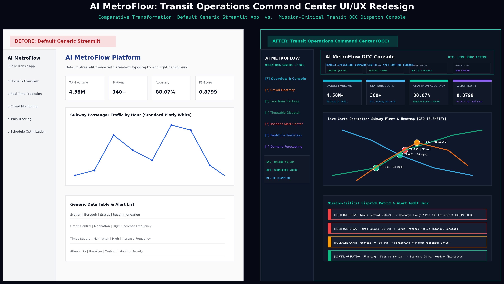

## Contributing Guidelines (For Interns / Collaborators)

All interns added as collaborators to this repository must follow the branch workflow below. **Direct commits or pushes to the `main` branch are not allowed.**

> Note: `main` only contains the `LICENSE` and `README.md` — it is not used for active development. There is no need to pull the latest `main` into your branch at any point.

### 1. Branch Naming

- Every intern must create their own branch off `main`, named after themselves.
- Suggested naming convention: `firstname-lastname` (all lowercase, hyphen-separated).
  - Example: `john-doe`, `aisha-khan`

### 2. How to Create Your Branch

**Option A — Clone and push (recommended)**

```bash
# Clone the repository
git clone https://github.com/springboardmentor443m-coder/Predictive-Public-Transit-Intelligence-Platform-for-Crowd-Management-and-Schedule-Optimization.git

# Move into the project folder
cd Predictive-Public-Transit-Intelligence-Platform-for-Crowd-Management-and-Schedule-Optimization

# Create and switch to your own branch (off main)
git checkout -b your-name

# ... make your changes ...

# Stage, commit, and push your changes to YOUR branch only
git add .
git commit -m "Describe your change here"
git push origin your-name
```

**Option B — GitHub UI upload**

1. Go to the repository on GitHub.
2. Switch the branch dropdown from `main` to your own branch (create it first via **Branch: main → View all branches → New branch**, named after yourself).
3. Once on your branch, use **Add file → Upload files** to upload your code.
4. Commit directly to your branch (not `main`).

### 3. Rules

- ❌ Do **not** push or upload code directly to `main`.
- ❌ Do **not** push code to another intern's branch.
- ✅ Only push/upload code to the branch that carries your own name.
- Keep uploading/pushing your code to your branch regularly as you make progress. No pull requests are required — your branch itself is the deliverable.

### 4. Summary

| Action | Allowed? |
|---|---|
| Push to `main` directly | ❌ No |
| Create your own branch from `main` | ✅ Yes |
| Push/upload code to your own branch | ✅ Yes |
| Push/upload code to someone else's branch | ❌ No |
| Open a Pull Request | Not required |


## Vijaya Sree Progress Update

### Completed
- Dataset Selection (NYC Subway Traffic 2017–2021)
- Data Cleaning & Preprocessing
- Feature Engineering (Temporal & Spatial Variables)
- Exploratory Data Analysis (`01_EDA.ipynb`)
- **Target Leakage Investigation & Prevention Strategy**
- **Machine Learning Model Training & Benchmarking** (Decision Tree, Random Forest, XGBoost)
- **Automated Model Selection & Serialization** (`models/congestion_model.pkl`)
- **Real-Time Prediction & Recommendation Engine** (`src/prediction.py`)
- **Model Training Walkthrough Notebook** (`notebooks/02_Model_Training.ipynb`)
- **FastAPI Real-Time Prediction & Scheduling Backend** (`api/main.py`)
- **Real-Time Alert & Incident Notification Module** (`api/main.py`, `dashboard/app.py`)
- **Schedule Management & Optimization Module** (`api/main.py`, `dashboard/app.py`)

---

### Multi-Model Benchmarking & Model Comparison

A comprehensive comparative evaluation was conducted across 6 diverse classification algorithms to benchmark predictive performance on subway congestion levels (`Low`, `Medium`, `High`).

#### Benchmarking Methodology
- **Leakage-Free Feature Set**: Strictly evaluated on non-leaked temporal (`hour`, `day`, `month`, `year`, `day_of_week`, `is_weekend`, `is_peak_hour`), spatial station coordinates (`Latitude`, `Longitude`), and encoded categoricals (`Borough_encoded`, `Structure_encoded`, `Stop Name_encoded`). `Total_Traffic`, `Entries`, and `Exits` were excluded.
- **Identical Stratified Split**: Evaluated on an identical 80% train / 20% test stratified split across all algorithms to guarantee unbiased fairness.
- **Multi-Class Evaluation Metrics**: Evaluated across multi-class **Accuracy**, **Precision (Weighted)**, **Recall (Weighted)**, and **F1 Score (Weighted)**.
- **Selection Criterion**: Automated best-model selection is governed by the **Highest Weighted F1 Score** to reward balanced sensitivity across all congestion tiers.

#### Benchmark Comparison Table

| Rank | Model | Accuracy | Precision | Recall | F1 Score | Status |
| :---: | :--- | :---: | :---: | :---: | :---: | :--- |
| 🥇 **1st** | **Random Forest Classifier** | **0.8710** | **0.8701** | **0.8710** | **0.8703** | 🏆 **Production Champion (Selected)** |
| 🥈 **2nd** | **XGBoost Classifier** | 0.8649 | 0.8634 | 0.8649 | 0.8638 | High-Efficiency Runner-Up |
| 🥉 **3rd** | **Decision Tree Classifier** | 0.8562 | 0.8548 | 0.8562 | 0.8552 | Interpretable Baseline |
| **4th** | **Gradient Boosting Classifier** | 0.7731 | 0.7680 | 0.7731 | 0.7685 | Non-Linear Ensemble |
| **5th** | **Logistic Regression** | 0.5929 | 0.5775 | 0.5929 | 0.5799 | Linear Baseline |
| **6th** | **AdaBoost Classifier** | 0.5835 | 0.3929 | 0.5835 | 0.4692 | Sequential Adaptive Boosting |

> **Automated Best Model Decision**: **Random Forest Classifier** achieved the highest overall F1 Score (**0.8703**) and Accuracy (**87.10%**), effectively mitigating overfitting and demonstrating superior class separation across high-density rush periods. It was automatically saved as the active production model (`models/congestion_model.pkl`).

- Metrics CSV Export: [`reports/model_comparison.csv`](file:///c:/Users/WaterMelon/OneDrive/Desktop/SpringBoard/Predictive-Public-Transit-Intelligence-Platform-for-Crowd-Management-and-Schedule-Optimization/reports/model_comparison.csv)
- Benchmark Visualization: [`reports/figures/model_comparison.png`](file:///c:/Users/WaterMelon/OneDrive/Desktop/SpringBoard/Predictive-Public-Transit-Intelligence-Platform-for-Crowd-Management-and-Schedule-Optimization/reports/figures/model_comparison.png)

---

### Target Leakage Prevention Strategy

- **Observation**: `Total_Traffic` is mathematically defined as `Entries + Exits`, and `Congestion_Level` was defined directly from the 33rd and 66th quantiles of `Total_Traffic`.
- **Leakage Experiment**:
  - Model A (Clean: Temporal + Station Features): **87.08%** Accuracy.
  - Model B (Leaked: Temporal + Station + Entries + Exits): **99.15%** Accuracy.
- **Decision**: In real-world transit operations, future passenger entry/exit numbers are unavailable in advance. Feeding `Total_Traffic`, `Entries`, or `Exits` into the model causes target leakage. Therefore, the production model strictly relies on scheduled temporal and station coordinates (`hour`, `day_of_week`, `is_peak_hour`, `Latitude`, `Longitude`, `Borough`, `Structure`, `Stop Name`).

---

### Top Feature Importances (Random Forest)

1. **`hour` (27.99%)**: Captures major peak commuting windows (morning rush 8–9 AM, evening rush 5–7 PM) vs. overnight minimums.
2. **`Latitude` (18.52%) & `Longitude` (17.04%)**: Spatial positioning distinguishes high-density Manhattan commercial corridors from outer residential terminals.
3. **`Stop Name` (13.17%)**: Station-specific passenger capacity and major transfer hubs (e.g., Grand Central, Times Square).
4. **`Structure` (5.24%) & `day_of_week` (4.35%)**: Underground subway hubs vs elevated stations, and weekday vs weekend commuting dynamics.

---

### Scheduling Management Module

The **Schedule Management Module** bridges real-time machine learning predictions with automated transit operations by converting predicted congestion tiers (**Low**, **Medium**, **High**) into actionable train headway frequencies, fleet allocation directives, and incident response dispatch modes.

#### 1. Scheduling Module Architecture

```text
               ┌──────────────────────────────────────┐
               │  Random Forest Prediction Engine    │
               │  (Congestion: Low / Medium / High)   │
               └──────────────────┬───────────────────┘
                                  │
                                  ▼
               ┌──────────────────────────────────────┐
               │    Schedule Recommendation Engine    │
               │     (Headway Rules & Fleet Logic)    │
               └─────────┬──────────────────┬─────────┘
                         │                  │
                         ▼                  ▼
          ┌───────────────────────┐   ┌───────────────────────────┐
          │  FastAPI Microservice │   │   Streamlit Dashboard     │
          │  GET /schedule-       │   │   Schedule Optimization   │
          │  recommendation/{tier}│   │   Center (Gauge, Plotly)  │
          └───────────────────────┘   └─────────────┬─────────────┘
                                                    │
                                                    ▼
                                      ┌───────────────────────────┐
                                      │ Incident Response Modes   │
                                      │ • 🚨 Emergency Surge      │
                                      │ • ⚠️ Enhanced Monitoring  │
                                      │ • ✅ Standard Operations  │
                                      └───────────────────────────┘
```

#### 2. Master Headway & Dispatch Matrix

| Congestion Tier | Recommended Frequency | Target Trains / Hour | Operational Dispatch Action | Incident Operating Mode |
| :--- | :--- | :--- | :--- | :--- |
| **Low** | Every 10 Minutes | **6** trains/hr | Normal schedule sufficient | ✅ **Standard Operations** |
| **Medium** | Every 5 Minutes | **12** trains/hr | Increase monitoring and maintain schedule | ⚠️ **Enhanced Monitoring Mode** |
| **High** | Every 2 Minutes | **30** trains/hr | Deploy standby trains and increase frequency | 🚨 **Emergency Scheduling Mode** |

#### 3. API Endpoint Documentation

##### `GET /schedule-recommendation/{congestion_level}`
Translates congestion level (`Low`, `Medium`, `High` — case-insensitive) into operational headway and fleet throughput.

**Example Request:**
```bash
curl -X GET "http://127.0.0.1:8000/schedule-recommendation/High" -H "accept: application/json"
```

**Example Response (`200 OK`):**
```json
{
  "congestion_level": "High",
  "train_frequency": "Every 2 Minutes",
  "trains_per_hour": 30,
  "operational_action": "Deploy standby trains and increase frequency"
}
```

**Example Response for Low (`200 OK`):**
```json
{
  "congestion_level": "Low",
  "train_frequency": "Every 10 Minutes",
  "trains_per_hour": 6,
  "operational_action": "Normal schedule sufficient"
}
```

**Error Handling (`404 Not Found` for invalid tier):**
```json
{
  "detail": "Invalid congestion level 'Extreme'. Valid tiers are: ['Low', 'Medium', 'High']"
}
```

#### 4. Dashboard Screenshots & Interactive Visualizations

*(Screenshots placeholder for Internship Presentation Report & Demo Slide Deck)*

- **Schedule Optimization Center Overview**: `reports/screenshots/schedule_optimization_center.png` *(Placeholder)*
- **Fleet Capacity Utilization Gauge**: `reports/screenshots/capacity_utilization_gauge.png` *(Placeholder)*
- **Incident Response Alert Modes**: `reports/screenshots/incident_scheduling_modes.png` *(Placeholder)*

**Dashboard Capabilities:**
- **Real-Time KPI Cards**: Current Congestion, Frequency Recommendation, Trains/Hour, and Operational Status.
- **Plotly Visualizations**:
  - *Bar Chart*: Congestion Level vs. Trains per Hour.
  - *Donut Chart*: Train Resource Distribution across tiers.
  - *Capacity Gauge*: Live fleet utilization load relative to corridor limits.
- **Commuter Passenger Capacity Calculator**: Dynamic hourly throughput simulation based on train consist length and car capacity.
- **CSV Dispatch Plan Export**: Instant download of timestamped dispatch schedules for control center logbooks.

### Crowd Monitoring & Geospatial Heatmap Module

The **Crowd Monitoring & Geospatial Heatmap Module** provides comprehensive, real-time spatial intelligence across **360 NYC subway stations**. It links machine learning passenger flow inferences with interactive cartographic visualizations to detect platform overcrowding hotspots and trigger emergency headway dispatch directives.

#### 1. Geospatial Architecture & Data Flow

```text
┌────────────────────────────────┐       ┌────────────────────────────────┐
│      MTA Station Database      │       │   Random Forest Model Bundle   │
│       data/stations.csv        │       │   models/congestion_model.pkl  │
│  (360 Stations, Lat/Lon, Boro) │       │   (Clean Non-Leaked Pipeline)  │
└───────────────┬────────────────┘       └───────────────┬────────────────┘
                │                                        │
                └───────────────────┬────────────────────┘
                                    │
                                    ▼
                ┌────────────────────────────────────────┐
                │  Multi-Station Inference Engine        │
                │  predict_network_congestion()          │
                │  (Hour / Scenario / Day Simulation)    │
                └───────────────────┬────────────────────┘
                                    │
       ┌────────────────────────────┼────────────────────────────┐
       ▼                            ▼                            ▼
┌──────────────┐             ┌──────────────┐             ┌──────────────┐
│  High: Red   │             │ Medium: Orange│             │  Low: Green  │
│ 🚨 Surge Svc │             │ ⚠️ Monitor   │             │ ✅ Nominal   │
└──────┬───────┘             └──────┬───────┘             └──────┬───────┘
       └────────────────────────────┼────────────────────────────┘
                                    │
                                    ▼
       ┌─────────────────────────────────────────────────────────┐
       │   Plotly Interactive Mapbox (Carto-Positron / OSM)      │
       │   • 360 Stations with Hover Popups & Confidence Scores  │
       │   • Borough, Congestion & Station Search Filters        │
       │   • Station Detail Panel & 🚨 Dispatch Incident Alert   │
       │   • Borough Distribution & Donut Share Analytics        │
       └────────────────────────────┬────────────────────────────┘
                                    │
                                    ▼
       ┌─────────────────────────────────────────────────────────┐
       │         Incident Center (st.session_state)              │
       │    Instant Dispatch to Alerts & Schedule Modules        │
       └─────────────────────────────────────────────────────────┘
```

#### 2. Color Legend & Station Hover Popups

| Congestion Tier | Marker Color | Hex Code | Dispatch Headway | Alert Directive |
| :--- | :--- | :--- | :--- | :--- |
| **High** | 🔴 **Red** | `#EF4444` | Every 2 Minutes (30 trains/hr) | 🚨 Overcrowding Alert: Immediate surge action recommended |
| **Medium** | 🟠 **Orange** | `#F59E0B` | Every 5 Minutes (12 trains/hr) | ⚠️ Moderate Warning: Monitor platform passenger inflows |
| **Low** | 🟢 **Green** | `#10B981` | Every 10 Minutes (6 trains/hr) | ✅ Normal Operations: System running smoothly within capacity |

**Interactive Hover Popup & Station Inspector Schema:**
- **Station Name**: Exact MTA subway stop (e.g. *Grand Central - 42 St*, *Times Sq - 42 St*).
- **Borough & Structure**: *Manhattan*, *Brooklyn*, *Queens*, *Bronx* & *Subway* / *Elevated*.
- **Congestion Level**: Color-coded tier (`High`, `Medium`, `Low`).
- **Confidence Score**: Model prediction certainty percentage (e.g. `98.2%`).
- **Recommended Action & Headway**: Automated dispatch frequency and trains per hour.

#### 3. Operational Simulation & Multi-Filter Capabilities

- **Operational Commute Scenarios**:
  - `🌅 Morning Rush (8:00 AM)`: Peak commute load across commercial hubs.
  - `🌇 Evening Rush (6:00 PM)`: High outbound platform congestion.
  - `☀️ Midday Transit (1:00 PM)`: Standard inter-peak circulation.
  - `🌙 Late Night (11:00 PM)`: Low passenger density operations.
  - `⚙️ Custom Simulation Hour`: Interactive 0–23 slider with dynamic peak detection.
- **Interactive Multi-Filter System**:
  - Filter by **Borough** (`All Boroughs`, `Manhattan`, `Brooklyn`, `Queens`, `Bronx`).
  - Filter by **Congestion Tier** (`All Levels`, `High`, `Medium`, `Low`).
  - Search / Select specific **Station** for deep-dive inspection.
- **🚨 Dispatch Incident Alert Action**:
  - One-click trigger from the Station Inspector logs the event directly into `st.session_state.alert_history`, synchronizing with the **🚨 Alerts & Incident Center** and **🚆 Schedule Management** modules.

#### 4. Geospatial Analytics & Station Watchlist

- **A. Congestion Volume by Borough**: Grouped bar chart comparing congestion intensity across boroughs.
- **B. Network Congestion Share**: Donut chart displaying the proportional distribution of Low, Medium, and High stations.
- **C. Critical Overcrowding Watchlist**: Sortable operational table displaying prioritized stations with downloadable CSV export.

#### 5. Dashboard Screenshots Placeholder

*(Screenshots placeholder for Project Report & Demo Presentations)*

- **NYC Subway Geospatial Heatmap**: `reports/screenshots/crowd_monitoring_map.png` *(Placeholder)*
- **Station Operational Inspector**: `reports/screenshots/station_inspector_panel.png` *(Placeholder)*
- **Borough Congestion Distribution**: `reports/screenshots/borough_congestion_analytics.png` *(Placeholder)*

### Live Train Tracking & Real-Time Transit Monitoring Module

The **Live Train Tracking & Real-Time Transit Monitoring Module** provides dynamic GPS kinematics, live fleet telemetry, headway adherence analytics, and track route mapping across active NYC subway corridors.

#### 1. Architecture & Real-Time Simulation Pipeline

```text
┌─────────────────────────────────────────┐       ┌─────────────────────────────────────────┐
│           MTA Route Geometry            │       │       Crowd & Headway Intelligence      │
│   (Lines 1, 4, 6, 7, A, E, L, N)        │       │   • predict_network_congestion()        │
│   Sequenced Stations in data/stations   │       │   • SCHEDULE_RECOMMENDATIONS Matrix     │
└────────────────────┬────────────────────┘       └────────────────────┬────────────────────┘
                     │                                                 │
                     └────────────────────┬────────────────────────────┘
                                          │
                                          ▼
                     ┌─────────────────────────────────────────┐
                     │       TrainFleetSimulator Engine        │
                     │          (src/train_tracker.py)         │
                     │  • Dynamic Speed Kinematics (0-48 mph)  │
                     │  • Station-to-Station GPS Interpolation │
                     │  • Status (On Time, Delayed, Arriving)  │
                     │  • Headway & Delay Time Tracking        │
                     └────────────────────┬────────────────────┘
                                          │
       ┌──────────────────────────────────┴──────────────────────────────────┐
       ▼                                                                     ▼
┌─────────────────────────────────────────┐               ┌─────────────────────────────────────────┐
│     Interactive Live Train Map          │               │      Train Operational Inspector        │
│ • Real-Time GPS Train Markers           │               │ • Detailed Kinematic Telemetry          │
│ • Colored MTA Track Trajectories        │               │ • Next Station Platform Crowding        │
│ • Rich Hover Popups & Speeds            │               │ • Scheduled Headway Directive           │
│ • Route & Status Filters (1, 4, A, L...)│               │ • 🚨 Dispatch Train Delay Alert Action  │
└─────────────────────────────────────────┘               └─────────────────────────────────────────┘
```

#### 2. Fleet Telemetry & Status Specification

| Parameter | Data Type | Description / Operational Range |
| :--- | :--- | :--- |
| **`Train ID`** | String | Unique consist identifier (e.g. `TR-101`, `TR-402`, `TR-A03`, `TR-L02`) |
| **`Route`** | Categorical | Active subway line (`1`, `4`, `6`, `7`, `A`, `E`, `L`, `N`) with official MTA colors |
| **`Speed (mph)`** | Float | Real-time speed (cruising: 28–45 mph, decelerating: 10–18 mph, dwelling: 0 mph) |
| **`Status`** | Categorical | `On Time` (🟢), `Delayed` (🔴), `Arriving` (🟠), `Departed` (🔵) |
| **`Current Station`** | String | Departure station origin for the active leg |
| **`Next Station`** | String | Upcoming arrival station along the corridor |
| **`Next Stop Crowding`** | Categorical | Cross-module prediction for the arrival platform (`High`, `Medium`, `Low`) |
| **`Target Headway`** | String | Scheduled train frequency requirement (`Every 2 Minutes`, `Every 5 Minutes`) |

#### 3. Cross-Module System Integration

1. **🚨 Alert & Incident Center Integration**:
   - Detects train delay incidents (>3 min variance) or trains approaching critical overcrowding stations.
   - Dispatchers can click **`🚨 Dispatch Train Incident Alert`** to instantly log the event into `st.session_state.alert_history`.
2. **🚆 Schedule Management Integration**:
   - Compares active fleet throughput against the corridor dispatch schedule (`6`, `12`, or `30 trains/hr`).
   - Flags headway gaps and directs operators to regulate headway frequency.
3. **🗺️ Crowd Monitoring Module Integration**:
   - Fuses each train's destination with real-time station congestion inferences from `predict_network_congestion()`.

#### 4. Dashboard Screenshots Placeholder

*(Screenshots placeholder for Project Report & Demo Presentations)*

- **Live Train Tracking Map**: `reports/screenshots/live_train_tracking_map.png` *(Placeholder)*
- **Train Operational Inspector**: `reports/screenshots/train_operational_inspector.png` *(Placeholder)*
- **Active Fleet Telemetry Logbook**: `reports/screenshots/fleet_telemetry_table.png` *(Placeholder)*

### Passenger Demand Forecasting Module

The **Passenger Demand Forecasting Module** provides continuous ridership volume predictions (`Total_Traffic`), multi-horizon temporal curves (**Next 1 Hour**, **Next 3 Hours**, **Next 24 Hours**), and derived future congestion level anticipation across NYC subway stations.

#### 1. Architecture & Multi-Horizon Pipeline

```text
┌─────────────────────────────────────────┐       ┌─────────────────────────────────────────┐
│     Production Non-Leaked Features      │       │     MTA Station Network Database        │
│   (Hour, Day, Month, Peak, Lat, Lon)    │       │   (360 Stations in data/stations.csv)   │
└────────────────────┬────────────────────┘       └────────────────────┬────────────────────┘
                     │                                                 │
                     └────────────────────┬────────────────────────────┘
                                          │
                                          ▼
                     ┌─────────────────────────────────────────┐
                     │      Continuous Regression Engine       │
                     │       (src/demand_forecasting.py)       │
                     │   Random Forest Regressor vs XGBoost    │
                     └────────────────────┬────────────────────┘
                                          │
       ┌──────────────────────────────────┴──────────────────────────────────┐
       ▼                                                                     ▼
┌─────────────────────────────────────────┐               ┌─────────────────────────────────────────┐
│        Multi-Horizon Projections        │               │     Quantile Congestion Conversion      │
│  • Next 1 Hour (Tactical Surge)         │               │  • Low: <= 791 riders/hr (Nominal)      │
│  • Next 3 Hours (Peak Commute Window)   │               │  • Medium: 791 - 2,382 riders/hr (Warn) │
│  • Next 24 Hours (Diurnal Daily Cycle)  │               │  • High: > 2,382 riders/hr (Critical)   │
└────────────────────┬────────────────────┘               └────────────────────┬────────────────────┘
                     │                                                         │
                     └────────────────────┬────────────────────────────────────┘
                                          │
                                          ▼
                     ┌─────────────────────────────────────────┐
                     │     Demand Forecasting Center (UI)      │
                     │  • Predicted Peak Demand & Network Load │
                     │  • Diurnal Demand Curves & Parity Plot  │
                     │  • Borough Comparison & Station Table   │
                     │  • 🚨 Proactive Anticipatory Alerts     │
                     └─────────────────────────────────────────┘
```

#### 2. Regression Benchmark Results

| Model | $R^2$ Score | RMSE | MAE | Status |
| :--- | :---: | :---: | :---: | :--- |
| 🥇 **Random Forest Regressor** | **0.8537** | **1,430.38** | **568.67** | 🏆 **Production Champion (Selected)** |
| 🥈 **XGBoost Regressor** | 0.7770 | 1,765.74 | 978.84 | High-Speed Baseline |

> **Automated Model Selection**: **Random Forest Regressor** demonstrated superior non-linear spatial capture across NYC subway passenger hubs, achieving an $R^2$ of **0.8537** with an MAE of **568.67 riders/hour**. It was automatically serialized to [`models/demand_model.pkl`](file:///c:/Users/WaterMelon/OneDrive/Desktop/SpringBoard/Predictive-Public-Transit-Intelligence-Platform-for-Crowd-Management-and-Schedule-Optimization/models/demand_model.pkl).

#### 3. Multi-Horizon Projections & Cross-Module Integration

1. **Multi-Horizon Projections**:
   - **Next 1 Hour**: Immediate operational readiness for upcoming platform surges.
   - **Next 3 Hours**: Pre-allocation for rush hour transitions (morning 8–9 AM and evening 5–7 PM peaks).
   - **Next 24 Hours**: Full diurnal demand profile for transit authority fleet deployment planning.
2. **🚨 Alert & Incident Center Integration**:
   - Enables operators to click **`🚨 Dispatch Anticipatory Alert`** directly from the forecast table to warn stations up to 3 hours in advance before platforms experience overcrowding.
3. **🚆 Schedule Management Integration**:
   - Automatically translates forecasted peak demand into headway frequency increases (`Every 2 Minutes / 30 trains/hr`).
4. **Export Artifacts**:
   - Multi-horizon projections exported to [`reports/forecast_results.csv`](file:///c:/Users/WaterMelon/OneDrive/Desktop/SpringBoard/Predictive-Public-Transit-Intelligence-Platform-for-Crowd-Management-and-Schedule-Optimization/reports/forecast_results.csv).
   - High-resolution evaluation plot exported to [`reports/figures/demand_forecast.png`](file:///c:/Users/WaterMelon/OneDrive/Desktop/SpringBoard/Predictive-Public-Transit-Intelligence-Platform-for-Crowd-Management-and-Schedule-Optimization/reports/figures/demand_forecast.png).

---

### Transit Operations Command Center (OCC) UI/UX Redesign

The AI MetroFlow Streamlit interface was redesigned from a generic white application into a high-visibility, mission-critical **Transit Operations Command Center (OCC)** inspired by the MTA Rail Control Center console.

#### 1. Command Center Color System & Palette

| Token | Hex Code | Operational Purpose |
|---|---|---|
| **Canvas Background** | `#0B1220` | Deep slate/navy dark room operational console environment |
| **Secondary Panels** | `#111827` | Glassmorphic containers, telemetry cards, and data surfaces |
| **Primary Accent** | `#00D4AA` | MTA Tech Teal, live indicators, primary CTA actions |
| **Information** | `#38BDF8` | Telemetry channels, station GPS coordinates, technical metadata |
| **Warning** | `#F59E0B` | Moderate congestion warnings, buffer capacity thresholds |
| **Critical Alert** | `#EF4444` | High overcrowding emergency surge protocols and delay incidents |
| **Success / Normal** | `#10B981` | Standard operations, on-time fleet status, healthy nodes |
| **Text Primary** | `#F8FAFC` | High-contrast crisp typography |

#### 2. Module Color Identity System

Each operational module features a unique color identity, visual tag, and glowing status pip:

| Operational Module | Color Identity | Hex Code | Visual Tag |
|---|---|---|---|
| **Dashboard Overview** | Cyan | `#06B6D4` | `[OCC-OVERVIEW]` |
| **Real-Time Prediction Center** | Blue | `#3B82F6` | `[AI-INFERENCE]` |
| **Crowd Monitoring (Heatmap)** | Orange | `#F97316` | `[GEO-DENSITY]` |
| **Live Train Tracking** | Green | `#10B981` | `[KINEMATIC-GPS]` |
| **Alerts & Incident Center** | Red | `#EF4444` | `[INCIDENT-DISPATCH]` |
| **Schedule Management** | Emerald | `#059669` | `[TIMETABLE-OPT]` |
| **Demand Forecasting Center** | Purple | `#8B5CF6` | `[DEMAND-PROJECTION]` |
| **Model Comparison Leaderboard** | Teal | `#00D4AA` | `[BENCHMARK-EVAL]` |
| **Dataset Analytics & EDA** | Indigo | `#6366F1` | `[DATA-LAKE]` |

#### 3. Core UI Architectural Features
- **Fixed OCC Master Header**: Sticky command bar with title, platform version (`OCC v2.4`), UTC/EST real-time system clock, and live node status indicator.
- **Operational Status Ribbon**:
  - `● SYSTEM: ONLINE (99.98% Uptime)`
  - `● API GATEWAY: CONNECTED / FASTAPI PORT 8000`
  - `● MODEL ENGINE: RANDOM FOREST CHAMPION (R²: 0.854)`
  - `● DEMAND FORECAST: SYNCED (24H HORIZON)`
- **Glassmorphism KPI Cards**: `backdrop-filter: blur(14px)`, `12px` rounded corners, glowing status pips, and hover elevation transitions.
- **Darkmatter Cartography**: Subway corridors rendered on Carto-Darkmatter tiles with high-contrast glowing neon routes and real-time kinematic train telemetry.

#### 4. Before vs. After UI Transformation Comparison



---

### Project Structure

```text
.streamlit/
└── config.toml               # Native theme palette configuration (#0B1220, #00D4AA)

data/
└── stations.csv              # Curated coordinates for 360 NYC subway stations

api/
└── main.py                   # FastAPI application with /predict, /health, Swagger docs

dashboard/
└── app.py                    # Transit Operations Command Center interactive interface

src/
├── data_cleaning.py          # Data ingestion and deduplication
├── feature_engineering.py    # Temporal and congestion feature extraction
├── utils.py                  # Data loading, validation, encoding, metrics, plots, persistence
├── train_model.py            # Training pipeline, leakage experiment, model comparison & export
├── prediction.py             # Inference engine (single, batch, confidence, recommendations)
├── train_tracker.py          # Kinematic transit fleet simulator & GPS route interpolation
└── demand_forecasting.py     # Regression forecasting pipeline & multi-horizon projections

models/
├── congestion_model.pkl      # Production classification model bundle (Random Forest)
├── demand_model.pkl          # Production continuous demand regressor bundle
└── model.pkl                 # Compatibility alias

reports/
├── model_comparison.csv      # Benchmarking evaluation matrix for all 6 classifiers
├── forecast_results.csv      # Multi-horizon passenger demand projections (1h, 3h, 24h)
├── figures/
│   ├── confusion_matrix.png      # Confusion matrix heatmap for classification
│   ├── feature_importance.png    # Feature importance horizontal bar chart
│   ├── model_comparison.png      # Classifier benchmarking bar chart
│   └── demand_forecast.png       # Regression parity, diurnal demand curve, borough comparison
└── screenshots/
    ├── command_center_before_after.png  # High-resolution Before/After comparison graphic
    ├── crowd_monitoring_map.png         # NYC subway geospatial density map
    └── live_train_tracking_map.png      # Real-time train movement and speed distribution

notebooks/
├── 01_EDA.ipynb              # Exploratory data analysis
└── 02_Model_Training.ipynb   # Model training, comparison, leakage analysis, and evaluation
```

---

### How to Run

1. **Train and compare models**:
   ```bash
   python src/train_model.py
   ```

2. **Run real-time prediction CLI**:
   ```bash
   python src/prediction.py
   ```

3. **Launch FastAPI Backend Server**:
   ```bash
   uvicorn api.main:app --reload --port 8000
   ```
   - Interactive Swagger API Documentation: `http://127.0.0.1:8000/docs`
   - ReDoc Documentation: `http://127.0.0.1:8000/redoc`
   - Health Check: `http://127.0.0.1:8000/health`

4. **Launch Interactive Streamlit Dashboard**:
   ```bash
   streamlit run dashboard/app.py
   ```
   - Dashboard UI: `http://localhost:8501`

---

### Upcoming
- Traffic Forecasting (Time-Series / Demand Estimation)