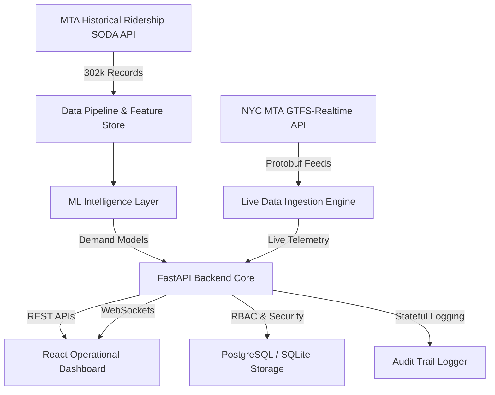

# MetroFlow System Architecture

## 📌 Architectural Overview

MetroFlow is built as a real-time, event-driven intelligent transportation management platform.

---

## 🏢 Backend Architecture (`/backend`)
- **Framework**: FastAPI (Async Python 3.11+)
- **Database & ORM**: PostgreSQL / SQLite fallback via SQLAlchemy
- **Authentication**: OAuth2 Password Flow with JWT Access Tokens & Bcrypt password hashing
- **Security & RBAC**: Enforced role-based access control (`ADMIN`, `OPERATOR`, `DISPATCHER`)
- **Audit Logging**: Stateful logging for logins, security events, profile updates, and operational alerts
- **Real-Time Layer**: Asynchronous WebSocket event broadcaster (`ConnectionManager`)

---

## 🎨 Frontend Architecture (`/frontend`)
- **Framework**: React 18 + TypeScript + Vite
- **Styling System**: Custom Dark Operations-Center Design System (Vanilla CSS + Tailwind CSS)
- **State Management**: Context-based Auth & Audit states + Custom Hooks (`useWebSocket`)
- **Charts & Visualization**: Canvas/SVG matrix visualizers, diurnal curves, topology graphs
- **Design Aesthetic**: Glassmorphism cards, cyan/blue operational accents (`#06b6d4`), responsive layout

---

## 🔒 Data State Declarations

MetroFlow strictly enforces data state boundaries:
1. **`LIVE`**: Verified real-time telemetry from official MTA GTFS-Realtime feeds (vehicle positions, trip delays, service alerts).
2. **`HISTORICAL`**: Validated NYC MTA ridership records (2022–2024).
3. **`PREDICTED`**: AI model outputs (demand forecasts, crowd risk levels, network congestion propagation).
4. **`UNAVAILABLE`**: Exact physical train-car occupancy and individual station turnstile exit taps (not provided in public MTA APIs; explicitly tagged `UNAVAILABLE` rather than estimated or simulated).
